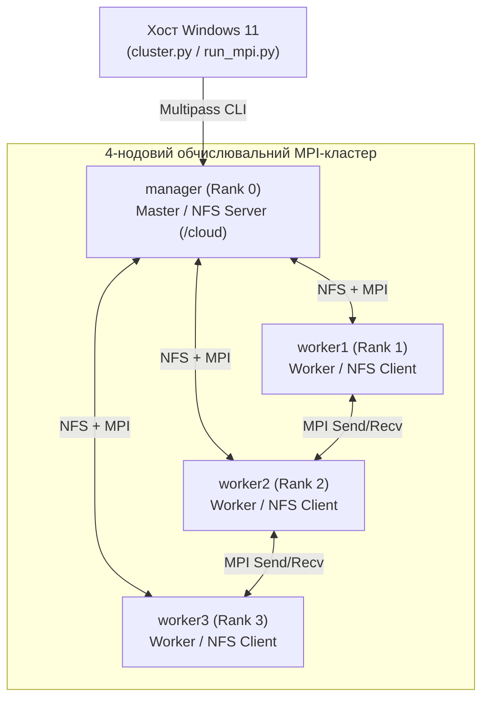

# Лабораторна робота №3: Розподілені обчислення на базі обчислювального MPI-кластера

## Мета роботи
1. **Інфраструктурна мета**: Розгорнути та налаштувати 4-нодовий обчислювальний кластер (`manager`, `worker1`, `worker2`, `worker3`) з використанням технологій віртуалізації (Canonical Multipass), мережевої файлової системи NFS та безпарольної автентифікації SSH.
2. **Алгоритмічна мета**: Дослідити концепції та інструменти міжнодової взаємодії бібліотеки **MPI (Message Passing Interface)** у парадигмі розподіленої пам'яті (Distributed Memory).
3. **Практична мета**: Перенести алгоритми з Лабораторних робіт №1 та №2 зі спільної пам'яті (Shared Memory / потоки) у розподілене кластерне середовище без використання файлового вводу-виводу:
   - **Завдання 1**: Розподілене сумування елементів великого масиву ($10^9$ елементів) з колективною редукцією (`MPI_Reduce`).
   - **Завдання 2**: Попарне хвильове додавання ("перший з останнім", метод здвоювання) з міжнодовою передачею повідомлень точка-точка (`MPI_Send` / `MPI_Recv`).

---

## 1. Архітектура та інфраструктура кластера

Кластер розгорнуто локально за допомогою гіпервізора **Hyper-V** та інструменту **Canonical Multipass**. Кластер складається з **4 віртуальних машин** під керуванням Ubuntu 26.04 / 24.04 LTS:

* **`manager` (Master Node / Rank 0)**:
  * Координатор завдань, вузол компіляції вихідного C-коду.
  * Виступає сервером **NFS (Network File System)**, експортуючи спільний каталог `/home/ubuntu/cloud`.
  * Ініціює запуск MPI-програм та агрегує фінальні результати.
* **`worker1`, `worker2`, `worker3` (Compute Nodes / Ranks 1–3)**:
  * Обчислювальні вузли (воркери).
  * Виступають клієнтами NFS: каталог `/home/ubuntu/cloud` автоматично монтується при запуску.
  * Виконують локальні обчислення та беруть участь у міжнодовому обміні даними.



---

## 2. Скрипти автоматизації та керування інфраструктурою

Для розгортання та супроводу кластера розроблено набір із чотирьох інструментів:

### 2.1. `cloud-init.yaml` — Конфігурація ініціалізації віртуальних машин
Використовується під час першого створення віртуальних машин через `multipass launch --cloud-init`. 
* **Критична оптимізація**: Зі стандартного переліку пакетів **вилучено** важкий пакет `openmpi-doc`. У нових версіях Ubuntu він підтягує залежності Node.js, веб-шрифти, Sphinx та MathJax (понад 1.5 ГБ даних), що раніше спричиняло переповнення стандартного диска ВМ (`No space left on device`).
* Встановлюються лише необхідні утиліти: `nfs-kernel-server`, `nfs-common`, `build-essential`, `openmpi-bin`, `libopenmpi-dev`.

### 2.2. `set_up_mpi.py` — Скрипт повного автоматизованого розгортання кластера
Повністю автоматизує створення кластера довільного розміру $S$ (у нашому випадку $S=4$):
1. Створює віртуальні машини (`manager`, `worker1..N-1`) із заданими параметрами пам'яті (`--ram 1536`), процесорів (`--cpu 1`) та **розширеного диска (`--disk 8G`)**.
2. Збирає призначені IP-адреси через JSON-вивід `multipass list`.
3. Оновлює системні файли `/etc/hosts` на всіх машинах для доступу за іменами.
4. Генерує RSA SSH-пари та взаємно налаштовує `~/.ssh/authorized_keys` з вимкненням `StrictHostKeyChecking`.
5. Конфігурує NFS-сервер на `manager` і монтує спільну теку на всіх воркерах з внесенням запису в `/etc/fstab`.
6. Формує файл `/home/ubuntu/cloud/mpi_hosts`.

```powershell
python set_up_mpi.py 4 --cpu 1 --ram 1536 --disk 8G
```

### 2.3. `cluster.py` — Менеджер життєвого циклу кластера (Старт / Стоп / Автооновлення IP)
На комп'ютерах під керуванням Windows віртуальний комутатор Hyper-V (DHCP) при кожному повторному запуску або перезавантаженні хоста видає віртуальним машинам нові динамічні IP-адреси. Скрипт `cluster.py` повністю усуває цю проблему в один клік:

* **Запуск (`python cluster.py start`)**:
  - Піднімає машини (`multipass start`).
  - Зчитує нові IP-адреси через JSON API Multipass.
  - Оновлює `/etc/hosts` на всіх 4 машинах (використовуючи прямий виклик `subprocess.run` з `shell=False`, щоб уникнути конфліктів Windows CMD із символами `|` та лапками).
  - Виконує ліниве розмонтування (`umount -f -l`) та повторне монтування (`mount -a`) теки NFS на воркерах, захищаючи від зависання застарілих файлових дескрипторів.
  - Проводить діагностику зв'язку по SSH і сигналізує про готовність.
* **Зупинка (`python cluster.py stop`)**:
  - Коректно зупиняє всі віртуальні машини (`multipass stop`), синхронізуючи файлові системи та миттєво вивільняючи оперативну пам'ять комп'ютера.
* **Статус (`python cluster.py status`)**: Відображає поточний стан машин.

### 2.4. `run_mpi.py` — Скрипт компіляції та виконання програм на кластері
Спрощує роботу розробника, автоматизуючи взаємодію з кластером:
* **Компіляція (`-c <file.c>`)**: Копіює вихідний код з Windows на `manager:cloud` через `multipass transfer` та компілює через `mpicc -O2` безпосередньо у спільній теці. Скомпільований файл через NFS миттєво стає доступним усім воркерам.
* **Запуск (`-r <binary> -n <num_proc> -a <args>`)**: Запускає програму через `mpiexec -hostfile /home/ubuntu/cloud/mpi_hosts -n 4 <binary> <args>`.

---

## 3. Теоретичні аспекти: Розподілена пам'ять та робота з 10^9 елементів

### 3.1. Чому не можна зберігати або пересилати 1 мільярд чисел цілком
* 1 000 000 000 32-бітних чисел (`int`) займають у пам'яті приблизно **4 ГБ RAM**.
* Наші віртуальні машини мають ліміт **1.5 ГБ RAM** кожна.
* Спроба виділити 4 ГБ масив на одній машині призведе до миттєвого аварійного завершення процесу системою захисту від переповнення пам'яті Linux (**OOM Killer**). Пересилання 4 ГБ через віртуальний мережевий стек суттєво уповільнило б кластер.

### 3.2. Децентралізоване виділення даних (Domain Decomposition)
Замість передачі масиву застосовано класичний HPC-підхід децентралізованої генерації:

$$\text{ChunkSize} = \frac{1\,000\,000\,000}{4} = 250\,000\,000$$

* Кожна нода виділяє у своїй RAM пам'ять **виключно під власний локальний шматочок** (250 млн елементів $\times 4$ байти $\approx 953$ МБ, що ідеально поміщається в ліміт 1.5 ГБ).
* Дані генеруються детерміновано безпосередньо в оперативній пам'яті кожної ноди.
* По мережі кластера передаються **виключно проміжні числа-суми (по 8 байтів)**.

---

## 4. Реалізація завдань лабораторної роботи

### 4.1. Завдання 1: Розподілене сумування масиву (`lab1_mpi_sum.c`)
Адаптація Лабораторної №1 під технологію MPI:
1. Кожен процес через `MPI_Comm_rank` та `MPI_Comm_size` обчислює межі свого діапазону.
2. Ноди одночасно виділяють пам'ять і підраховують локальну суму `local_sum` у 64-бітну змінну `long long`.
3. **Міжнодова взаємодія**: Виконується колективна операція редукції:
   ```c
   MPI_Reduce(&local_sum, &global_sum, 1, MPI_LONG_LONG, MPI_SUM, 0, MPI_COMM_WORLD);
   ```
   Воркери 1, 2, 3 упаковують свої локальні результати у пакети TCP/IP та передають на `manager` (Rank 0). Менеджер підсумовує їх зі своєю сумою, вимірює загальний час через `MPI_Wtime()` та виводить результат.

#### Запуск Завдання 1:
```powershell
# Компіляція
python run_mpi.py -c lab1_mpi_sum.c

# Запуск на 4 нодах для 1 мільярда елементів
python run_mpi.py -r lab1_mpi_sum -n 4 -a 1000000000
```

---

### 4.2. Завдання 2: Хвильове попарне додавання (`lab2_mpi_wave_sum.c`)
Адаптація Лабораторної №2 (метод здвоювання, попарне додавання симетричних елементів "перший з останнім, другий з передостаннім"):

Алгоритм реалізовано у два послідовні рівні:
1. **Внутрішньонодовий рівень**: Кожна з 4 нод паралельно згортає свій підмасив на 250 млн елементів класичним хвильовим методом:
   $$\text{arr}[i] = \text{arr}[i] + \text{arr}[\text{len} - 1 - i]$$
   зменшуючи довжину вдвічі на кожній ітерації до 1 проміжного значення.
2. **Міжнодовий рівень (Point-to-Point комунікація через `MPI_Send` / `MPI_Recv`)**:
   Отримані 4 значення згортаються між комп'ютерами за симетричним мережевим протоколом:
   * **Мережева Хвиля 1 (Активні ноди: 0, 1, 2, 3)**:
     - Пара $(0, 3)$: `worker3` відправляє значення `manager` (`MPI_Send` -> `MPI_Recv`).
     - Пара $(1, 2)$: `worker2` відправляє значення `worker1` (`MPI_Send` -> `MPI_Recv`).
     - Вузли 0 та 1 додають отримані пари. Вузли 2 і 3 завершують обчислення.
   * **Мережева Хвиля 2 (Активні ноди: 0, 1)**:
     - Пара $(0, 1)$: `worker1` відправляє значення `manager`.
     - `manager` виконує фінальне додавання і отримує загальну суму масиву.

#### Запуск Завдання 2:
```powershell
# Компіляція
python run_mpi.py -c lab2_mpi_wave_sum.c

# Запуск на 4 нодах для 1 мільярда елементів
python run_mpi.py -r lab2_mpi_wave_sum -n 4 -a 1000000000
```

---

## 5. Промпти для AI-асистента

Нижче наведено структуровану хронологію запитів (промптів), які використовувалися під час діалогу з ШІ-асистентом для проектування, розгортання та налагодження лабораторної роботи.

### Етап 1 — Аналіз матеріалів та вибір інструментів віртуалізації
> **Промпт 1:**
> Проаналізуй матеріали в папці Lab#3/Materials (курсова робота «Засоби автоматизованого розгортання MPI кластерів з використанням технологій віртуалізації та контейнеризації»). Поясни, яка технологія віртуалізації пропонується, чому обрано саме Canonical Multipass та OpenMPI замість VirtualBox/QEMU, та яку роль відіграє мережева файлова система NFS для виконання паралельних програм.

---

### Етап 2 — Діагностика мережевих повідомлень та MOTD
> **Промпт 2:**
> Я створив дві віртуальні машини manager та worker через Multipass на Windows. Під час входу в обох терміналах з'являється рядок: `Failed to connect to https://changelogs.ubuntu.com/meta-release-lts. Check your Internet connection or proxy settings`. Також команда `multipass shell manager` всередині ноди видає `multipass: command not found`. У чому причина цих помилок? Чи означає це, що віртуальні машини не бачать одна одну або не мають зв'язку? Протестуй DNS, ping та HTTP-доступність.

---

### Етап 3 — Вирішення проблеми переповнення диска (`No space left on device`)
> **Промпт 3:**
> Під час встановлення пакетів `sudo apt-get install -y build-essential openmpi-bin openmpi-doc libopenmpi-dev` на віртуальній машині менеджер процес перервався помилкою: `dpkg: error: cannot copy extracted data ... failed to write (No space left on device)`. Утиліта `mpicc` не знайдена, а `apt --fix-broken install` пропонує завантажити ще 555 МБ пакетів `gcc-16` при 447 МБ доступного місця. 
> Поясни, чому закінчилося місце на диску, який саме пакет спричинив переповнення, як безпечно очистити кеш і пакети документації без перевстановлення, та який мінімальний набір пакетів дійсно потрібен для збірки й запуску програм на OpenMPI.

---

### Етап 4 — Автоматизоване розгортання 4-нодового кластера
> **Промпт 4:**
> Мені потрібно виконати вимоги Лабораторної роботи №3: розгорнути повноцінний кластер з 4 нод (manager, worker1, worker2, worker3). Ручний сетап для 4 машин (обмін 12 SSH-ключами, редагування /etc/hosts, fstab) занадто громіздкий.
> Створи оптимізований `cloud-init.yaml` без важкої документації OpenMPI та напиши Python-скрипт `set_up_mpi.py` за зразком Розділу 3 курсової роботи, але з обов'язковим параметром виділення розширеного диска (`--disk 8G` або `10G`), щоб проблема переповнення пам'яті більше ніколи не виникала.

---

### Етап 5 — Розробка MPI-програм (Лаб 1 та Лаб 2) для розподіленої пам'яті
> **Промпт 5:**
> Кластер із 4 нод успішно запущений. Мені потрібно адаптувати завдання з Лабораторних №1 та №2 під MPI:
> 1. Поясни мені як новачку в MPI принципи моделі SPMD, різницю між Shared Memory і Distributed Memory, та роботу комунікаторів, rank і size.
> 2. Загальний розмір масиву — 1 000 000 000 елементів. Поясни, чому не можна передавати або створювати весь масив на одній ноді і як застосувати децентралізоване виділення пам'яті (Domain Decomposition).
> 3. Реалізуй Завдання 1 (`lab1_mpi_sum.c`): сума частин масиву з використанням колективної операції `MPI_Reduce`.
> 4. Реалізуй Завдання 2 (`lab2_mpi_wave_sum.c`): хвильове попарне додавання (перший з останнім) на двох рівнях — локальне згортання на кожній ноді та міжкластерні хвилі з пересиланням повідомлень через `MPI_Send` і `MPI_Recv`.

---

### Етап 6 — Автоматизація життєвого циклу кластера та виправлення конфліктів Windows Shell
> **Промпт 6:**
> Після вимкнення та повторного запуску кластера Hyper-V видає новим нодам інші динамічні IP-адреси.
> 1. Напиши скрипт `cluster.py` з командами `start`, `stop`, `status` для автоматичного перезапуску нод, зчитування нових IP, оновлення `/etc/hosts` та перемонтування NFS.
> 2. При виконанні команди виникла помилка: `'worker1' is not recognized as an internal or external command`, оскільки Windows `cmd.exe` інтерпретує вертикальну риску `|` у виразі `manager|worker1|worker2|worker3` як пайплайн. Усунь використання `shell=True` і зроби передачу команд безпосередньо у форматі масиву аргументів через системний Win32 API.
